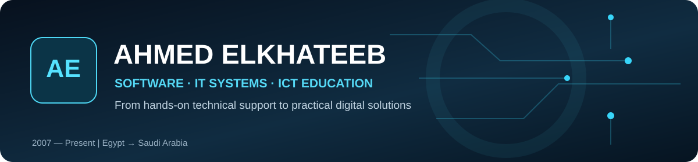
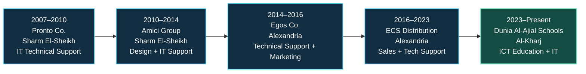
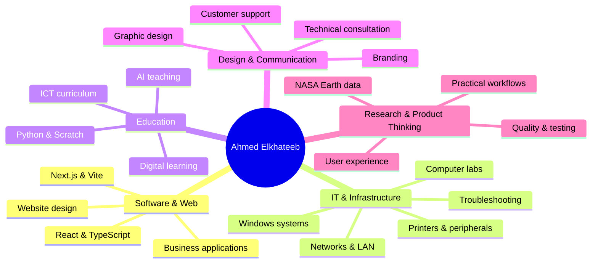
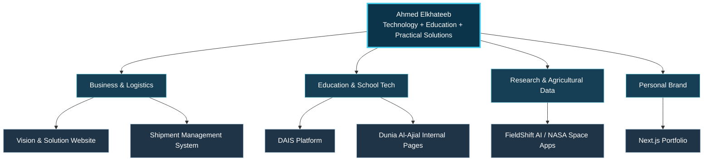

# Hi, I'm Ahmed Elkhateeb 👋
### أحمد عبد المنعم يوسف الخطيب

**Software & Web Development • IT Systems & Technical Support • ICT Education • AI for Learning**

**[🌐 Portfolio](https://ahmedelkhateeb-tech.vercel.app/)** · **[✉️ Email](mailto:a7mdel5taeeb@gmail.com)** · **[💬 WhatsApp](https://wa.me/966564227074)**

---

## 👨‍💻 About me | نبذة عني

I am a technology professional based in **Al-Kharj, Saudi Arabia**, combining **hands-on IT support**, **software and web projects**, **technical consulting**, and **computer education**. My career began in **Sharm El-Sheikh in 2007**, troubleshooting, maintaining and upgrading computers. It grew through design, technology sales, customer support and infrastructure work in Egypt, and continued into **ICT teaching and school technology operations** in Saudi Arabia.

Today, I serve as **Head of the ICT / Computer Department** at **Dunia Al-Ajial International Schools**, with responsibilities spanning ICT instruction, computer labs, IT support and practical technology integration. I also design and develop web-based systems and explore AI-assisted education and data-informed applications.

**بالعربي:** أنا أحمد الخطيب، متخصص في تطوير حلول الويب والبرمجيات، والدعم الفني وصيانة الحاسب والشبكات، وتعليم الكمبيوتر والبرمجة والذكاء الاصطناعي. بدأت رحلتي المهنية من الدعم الفني في **شرم الشيخ سنة 2007**، وانتقلت عبر مجالات التصميم والتسويق التقني والدعم الفني، وصولًا إلى تدريس تقنية المعلومات وقيادة قسم الحاسب في **مدارس دنيا الأجيال العالمية بالخرج**، مع العمل على مشروعات برمجية عملية.

> **My approach:** understand the real problem → design a simple experience → build thoughtfully → test → improve.  
> **مبدئي:** أفهم الاحتياج الحقيقي، وأبسّط الحل، وأنفّذه، وأختبره، ثم أطوّره.

## 🧭 My professional journey — visual roadmap

### 📍 Experience timeline | التاريخ المهني

| Period | Organization & location | Role and selected responsibilities |
|---|---|---|
| **Apr 2007 – May 2010** | **Pronto Co.** · Sharm El-Sheikh, Egypt | IT technical support; PC maintenance, troubleshooting, device upgrades and customer assistance. |
| **Jun 2010 – Jun 2014** | **Amici Group** · Sharm El-Sheikh, Egypt | Photography and graphic design alongside technical support; banners, brochures and promotional materials. |
| **Jul 2014 – Mar 2016** | **Egos Co.** · Alexandria, Egypt | Technical support and marketing; hardware/software maintenance, including work at Alexandria Dekheila Port, and technology sales support. |
| **Apr 2016 – Mar 2023** | **ECS Distribution** · Alexandria, Egypt | Technical support, sales and marketing; device configuration, diagnostics, maintenance and customer-facing hardware solutions. |
| **Apr 2023 – Present** | **Dunia Al-Ajial International Schools** · Al-Kharj, Saudi Arabia | ICT teaching, departmental leadership, computer-lab development, technical support and educational technology integration. |

<strong>🇸🇦 عرض المسيرة المهنية بالعربية</strong>

| الفترة | جهة العمل | الخبرة |
|---|---|---|
| أبريل 2007 – مايو 2010 | Pronto – شرم الشيخ | الدعم الفني وصيانة أجهزة الكمبيوتر وتطويرها |
| يونيو 2010 – يونيو 2014 | Amici Group – شرم الشيخ | التصوير والتصميم الإعلاني والدعم الفني |
| يوليو 2014 – مارس 2016 | Egos – الإسكندرية | الدعم الفني والتسويق وصيانة الأجهزة |
| أبريل 2016 – مارس 2023 | ECS Distribution – الإسكندرية | مبيعات التقنية والدعم الفني والتسويق |
| أبريل 2023 – حتى الآن | مدارس دنيا الأجيال العالمية – الخرج | تدريس الحاسب وقيادة القسم وتطوير المعامل والدعم الفني |

## 🧠 What I do — a connected skill system

### 🛠️ Technologies & areas of practice

| Domain | Working knowledge / interests |
|---|---|
| **Web & software** | HTML, CSS, JavaScript, TypeScript, React, Next.js, Vite, Tailwind CSS, Node.js, API integrations |
| **Data & applications** | Python, SQL, PostgreSQL, Supabase, web dashboards, reporting, Git & GitHub |
| **Infrastructure & support** | Windows, PC hardware & software support, local networks, troubleshooting, peripherals, computer-lab setup |
| **Teaching & AI** | ICT curricula, Python for students, Scratch, practical programming instruction, responsible AI learning |
| **Design & productivity** | Photoshop, Microsoft 365, design systems, bilingual interfaces (Arabic RTL / English LTR) |

*These are areas of experience and project use—not a claim of mastery of every tool or a computer-engineering academic degree.*

## 🚀 Selected projects | مشروعات مختارة

> Some repositories are **private**. A link to a private repository opens only for authorized collaborators. Development stage and live-demo availability are intentionally distinguished from production readiness.

| Project | What it is | Stack / focus | Access |
|---|---|---|---|
| 🚚 **[Vision & Solution — Corporate Website](https://github.com/a7mdel5taeeb-eng/V-SOLIOTION-)** | Bilingual logistics company website, service information and request forms | Static web, Vercel, Arabic/English | [Live site](https://www.vsolutions.co/) · Public repo |
| 🚛 **[Vision & Solution — Shipment Management System](https://github.com/a7mdel5taeeb-eng/vision-solution-shipment-system)** | Role-aware shipment registration, status lifecycle, overdue monitoring, admin reports and local connected security workflows | React, TypeScript, Vite, local Supabase/PostgreSQL | [Browser Demo](https://vision-solution-tms-demo.vercel.app/) · Private repo |
| 🌱 **[FieldShift AI — NASA Space Apps](https://github.com/a7mdel5taeeb-eng/fieldshift-ai)** | Research-oriented agricultural decision-support foundation with NASA environmental context and bilingual farm-location inputs | React, FastAPI, NASA POWER / SMAP | Public repo · [Web preview](https://fieldshift-ai-liard.vercel.app/) |
| 🏫 **[DAIS — School Digital Platform](https://github.com/a7mdel5taeeb-eng/dais)** | School-focused React application, digital interfaces and supporting server components | React, TypeScript, Express | Private repo |
| 🎓 **[Dunia Al-Ajial — Internal Pages](https://github.com/a7mdel5taeeb-eng/dunia-al-ajial-all-internal-pages)** | Bilingual internal school pages and reusable web UI | React, Vite, Tailwind | Private repo |
| 💼 **[Ahmed Elkhateeb — Portfolio](https://github.com/a7mdel5taeeb-eng/ahmedelkhateeb-tech)** | Personal digital identity and interactive web portfolio | Next.js, React, TypeScript | [Portfolio](https://ahmedelkhateeb-tech.vercel.app/) · Private repo |

### 🗺️ How my projects connect

## 🎓 Education, training & languages

- **Academic qualification:** Bachelor of Social Work, Egypt (**2010**).
- **Technical training/coursework recorded in my CV:** CCNA networking fundamentals, IT Essentials, ICDL, Windows, Microsoft Office, Photoshop and Visual Basic.
- **Languages:** Arabic (native) and English (excellent).
- **Professional development:** hands-on IT operations, school technology, practical software delivery and educational technology.

*Academic qualification and technical training are stated separately to avoid presenting coursework as an engineering degree or an unverified professional license.*

## 📊 GitHub activity & toolkit

*Dynamic cards are provided by a third-party service and can occasionally be unavailable. GitHub's own contribution graph remains the authoritative activity view. Private repository statistics may not be reflected.*

## 🤝 Collaboration & contact

I am interested in opportunities involving **web solutions, practical software systems, ICT education, AI for learning, IT support, networking and digital transformation**.

- 🌐 **Portfolio:** [ahmedelkhateeb-tech.vercel.app](https://ahmedelkhateeb-tech.vercel.app/)
- ✉️ **Email:** [a7mdel5taeeb@gmail.com](mailto:a7mdel5taeeb@gmail.com)
- 💬 **WhatsApp:** [Start a conversation](https://wa.me/966564227074)
- 💻 **GitHub:** [@a7mdel5taeeb-eng](https://github.com/a7mdel5taeeb-eng)

---

**Turning ideas into real solutions.**  
**من الفكرة إلى حل تقني حقيقي.**

Portfolio & experience summary last reviewed: November 2026. • Projects are documented according to their actual development state.

