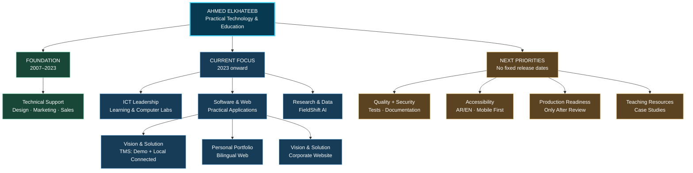
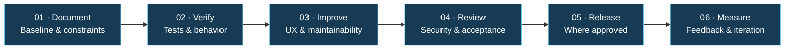

# 🧭 AHMED ELKHATEEB — DEVELOPMENT ROADMAP
### Professional Growth · Software Products · Education · IT Solutions
### خارطة التطوير المهني والمشروعات

**[⬅ Back to profile](README.md)** · **[🚀 Project portfolio](README.md#-selected-projects--مشروعات-مختارة)** · **[✉️ Contact](mailto:a7mdel5taeeb@gmail.com)**

---

> **Roadmap status — November 2026:** This is a personal portfolio-level **direction and planning document**, not a guaranteed delivery schedule or blanket approval to change project repositories. Actual implementation, deployment and approval states remain defined in each project's own README/status documents.

## 🏁 North Star | الرؤية

Build practical technology solutions where **software engineering, reliable IT systems, and accessible education** meet. Prioritize demonstrated user value, clear documentation, bilingual usability, safe deployments and maintainable code.

**الرؤية:** تطوير حلول رقمية عملية تجمع بين البرمجيات، والبنية التقنية الموثوقة، والتعليم المبسط؛ مع الاهتمام بتجربة المستخدم، ودقة التنفيذ، والتوثيق والاختبار.

## 🗺️ Portfolio evolution — visual roadmap

## 🎯 Strategic tracks

| Track | Current foundation | Next practical direction | Success evidence |
|---|---|---|---|
| **01 · Software & Web** | Corporate websites, bilingual portfolio, logistics app | Improve accessibility, test coverage, product documentation and delivery discipline | Reproducible builds, verified deployments, clear project case studies |
| **02 · IT Systems** | Long-term hardware/software support and school computer labs | Strengthen preventive maintenance, network troubleshooting, operational guides and asset practices | Documented runbooks and repeatable diagnostics |
| **03 · ICT & AI Education** | ICT teaching, coding lessons, digital learning environments | Build reusable lesson activities, practical coding exercises and responsible AI materials | Classroom-ready resources with clear learning outcomes |
| **04 · Data-informed Products** | FieldShift AI with NASA environmental data context | Strengthen data provenance, explain uncertainty and validate evidence before any recommendations | Traceable data sources, limitations, tests and honest product claims |

## 🚦 Delivery phases — from evidence to outcomes

These phases are a **repeatable working method**, not claims that every project has reached production.

## 📦 Project-by-project outlook

### 🚛 Vision & Solution — Shipment Management System
**Repository:** [vision-solution-shipment-system](https://github.com/a7mdel5taeeb-eng/vision-solution-shipment-system) *(private)*  
**Demo:** [Public demo](https://vision-solution-tms-demo.vercel.app/)

| Stage | Scope |
|---|---|
| ✅ Documented baseline | Bilingual Demo Mode, shipment lifecycle, role-aware UX |
| ✅ Locally verified Connected work | Auth/MFA, scoped shipment operations, RLS, dashboards and reports |
| 🟠 Review gate | Mobile-readability candidate, Draft PR #15 — owner approval required |
| ⬜ Future, not yet complete | Production cloud database, hardened deployment, invoice image uploads and scheduled email delivery |

**Important:** A shareable demo does **not** imply an operational production system. Follow [the project's definitive status log](https://github.com/a7mdel5taeeb-eng/vision-solution-shipment-system/blob/main/docs/PROJECT_STATUS.md) before development or deployment.

### 🌱 FieldShift AI — NASA Space Apps
**Repository:** [fieldshift-ai](https://github.com/a7mdel5taeeb-eng/fieldshift-ai) *(public)*

**Current:** Bilingual interface with farm-location workflows and documented NASA POWER / optional SMAP environmental context.  
**Next directions:** improve backend hosting/integration, robust loading and unavailable-data states, source attribution, practical farmer UX and independent scientific validation.  
**Non-claim:** the repository is **not** proof of scientifically validated crop recommendation logic or a production agricultural advisory product.

### 🌐 Vision & Solution — Corporate Website
**Repository:** [V-SOLIOTION-](https://github.com/a7mdel5taeeb-eng/V-SOLIOTION-) · **[Live website](https://www.vsolutions.co/)**

**Current:** Bilingual corporate site hosted on Vercel under the company's official domain.  
**Next directions:** consistent branding, mobile usability, semantic accessibility, working form checks and link hygiene — without disrupting production routes or DNS.

### 🏫 Dunia Al-Ajial digital projects
**Repositories:** [DAIS](https://github.com/a7mdel5taeeb-eng/dais) · [Internal Pages](https://github.com/a7mdel5taeeb-eng/dunia-al-ajial-all-internal-pages) *(private)*

**Current:** School-focused UI and application work.  
**Next directions:** streamline bilingual user experiences, improve accessible staff/student-facing components and document safe maintenance workflows. Do not disclose private school information or internal environments in public documentation.

### 💼 Personal portfolio
**Repository:** [ahmedelkhateeb-tech](https://github.com/a7mdel5taeeb-eng/ahmedelkhateeb-tech) *(private)* · **[Portfolio website](https://ahmedelkhateeb-tech.vercel.app/)**

**Current:** Next.js bilingual portfolio and GitHub profile presence.  
**Next directions:** publish evidence-based case studies, project screenshots with permission, clear service descriptions, and accessible contact/navigation flows.

## 📅 Focus board | لوحة الأولويات

| Priority | Action | Definition of done |
|---|---|---|
| **P1** | Keep GitHub profile and project READMEs accurate | No outdated production claims; links and diagrams match reality |
| **P1** | Preserve active project data and approved branches | No accidental resets, unreviewed merges or exposed credentials |
| **P1** | Audit FieldShift web preview and API connectivity | Demonstrable public access, clear backend-unavailable behavior |
| **P2** | Finish review gates for logistics mobile UI | Recorded owner acceptance and passing relevant checks |
| **P2** | Improve portfolio with authentic visual case studies | Screenshots, problem/solution/outcome and implementation status |
| **P3** | Build reusable ICT and AI teaching resources | Lesson-ready assets tested for learner level and clarity |

*Priorities indicate recommended focus only. They are not scheduled tasks or an authorization to modify projects automatically.*

## 🧪 Quality gates

- [ ] User problem and target audience are clearly defined.
- [ ] Arabic/English layouts and responsive behaviors are checked where relevant.
- [ ] No secrets or real customer/student information enter public repositories.
- [ ] Relevant lint, type, build and test commands pass.
- [ ] Deployment URLs and environment boundaries are verified.
- [ ] Capabilities are clearly labeled: **implemented**, **under review**, or **planned**.
- [ ] A release is approved before production data/services are connected.
- [ ] Documentation includes limitations and a reproducible verification path.

## 🧱 Principles

**Practicality over buzzwords · Evidence over claims · Accessible by design · Secure by default · Bilingual where it matters · Reversible changes · Continuous learning**

**العملية قبل المظاهر · التحقق قبل الادعاء · سهولة الاستخدام · الأمان · دعم العربية والإنجليزية · تطوير آمن قابل للمراجعة · تعلم مستمر**

---

### Build thoughtfully. Verify carefully. Share what works.

**[🏠 Return to Ahmed's GitHub profile](README.md)**

Roadmap established: November 2026 · Living document · Update after verified milestones and owner-approved changes.

